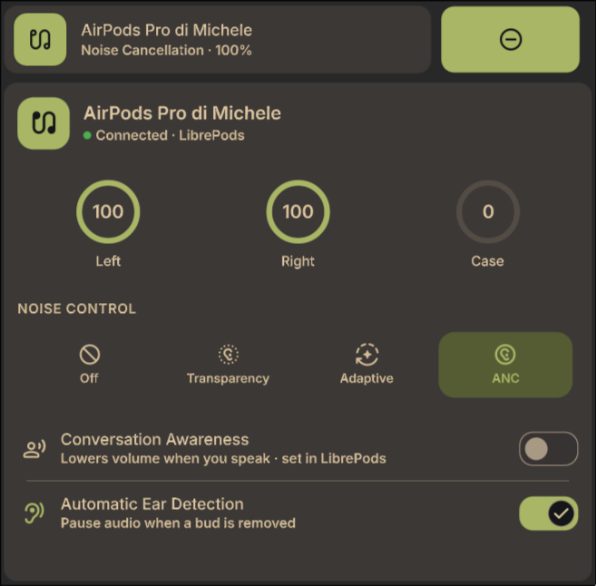
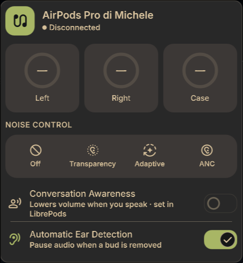

> DISCLAIMER: This widget was built with heavy assistance from LLMs (Claude). However, before publishing the plugin, the code was reviewed by me, for which I take responsibility.

# AirPods for DankMaterialShell

A batteries included DankMaterialShell (DMS) plugin that puts your AirPods in the bar and the Control Center - battery, noise modes and Conversation Awareness - powered by [LibrePods](https://github.com/kavishdevar/librepods) under the hood.

- **Bar pill** - an earbuds icon with the lowest bud level; a ring highlight when Conversation Awareness is active. Click it to open the popout panel.
- **Popout panel** - device name (with rename), per-bud + case battery rings, a four-way noise-control selector (Off / Transparency / Adaptive / Noise), and Conversation Awareness + Ear Detection rows.
- **Control Center tile** - click to cycle Noise ⇄ Transparency; click the empty area to reveal the full panel inline.




## How it talks to LibrePods

LibrePods has no public API, so the plugin shells out to [`scripts/librepods-bridge.sh`](scripts/librepods-bridge.sh), which uses the interfaces the running daemon already exposes:

| Feature | Direction | Mechanism |
| --- | --- | --- |
| Battery (L/R/case or headset) | read | tray `StatusNotifierItem` ToolTip |
| Noise mode + Conversation state | read | tray `DBusMenu` toggle-states |
| Device name + Ear Detection setting | read | `~/.config/AirPodsTrayApp/AirPodsTrayApp.conf` |
| Noise mode | **write** | `librepods-ctl noise:<mode>` |
| Ear Detection | **write** | config file (applies on next reconnect) |
| Rename | **write** | config file (applies on next reconnect) |

### Known LibrePods limitations (0.2.5)

- **Conversation Awareness is read-only.** LibrePods exposes no external way to toggle it - `librepods-ctl` only does noise, its control socket only accepts `noise:*`, and the tray menu ignores DBus activation events. The plugin shows the live state and points you at the LibrePods app to change it.
- **Ear Detection / Rename apply on reconnect.** They're written to LibrePods' config; the daemon reads them when the AirPods next connect. The plugin shows a toast reminding you.
- **LibrePods must be running** and the AirPods connected. If the daemon's tray icon fails to register (a startup race with the desktop portal), reads return "Disconnected" even though control still works - restart LibrePods.

## Requirements

- `librepods-ctl` and `dbus-send` on `PATH` (the plugin's startup check enforces this).
- The LibrePods daemon running with your AirPods paired.

## Install

Symlink (or copy) this repo into the DMS plugin directory so the directory name matches the plugin:

```sh
ln -s "$PWD" ~/.config/DankMaterialShell/plugins/AirPods
```

Then add the widget to your bar / Control Center from **DMS Settings → Widgets** (or **Control Center**), searching for *AirPods*.

> **home-manager / NixOS users:** if your DMS `settings.json` is a read-only symlink into `/nix/store`, you cannot add the widget from the GUI at runtime - declare it in your DMS configuration instead.

## Developing / hot-reload

Force a full unload + reload of the compiled component (bypasses the QML cache):

```sh
dms ipc plugin-scan reload airpods     # `call` is optional: `dms ipc call …` is equivalent
```

**Then close and re-open the surface you're testing.** `reload` swaps the plugin *component*, but DMS creates the widget *instances* lazily - the Control Center tile/detail and the bar popout are each instantiated the moment you open them. An already-open Control Center keeps its old instance until you close and reopen it, so edits can look like they "didn't apply" when the component actually did reload. Closing the surface (or, worst case, restarting the shell) guarantees a fresh instance on the new code.

Other IPC helpers:

- `dms ipc plugin-scan rescan airpods` - re-read the manifest only.
- `dms ipc plugin-scan scan` - rescan the whole plugin directory.

Watching live QML errors from the running shell (plugin `console.log` is **not** routed here - only QML compile errors and core `Log.scoped` messages appear):

```sh
dms-share=$(quickshell list --all | grep -oE '/nix/.*/dms' | head -1)
quickshell -p "$dms-share" log | grep -i airpods
```

The `pollInterval` (how often the bridge is polled for status) is configurable in the plugin's settings - default 5s.

### One quirk worth knowing: the Control Center *detail* has no plugin service

DMS renders a Control Center tile's expanded detail on a *throwaway* widget instance created with `pluginComponent.createObject(null)` - no `pluginService` and an empty `pluginId`. A plugin that reaches for `pluginService` (or `getPluginPath`) to fetch its data will therefore show nothing in the detail even though the collapsed tile works. This plugin sidesteps that by resolving the bridge script **relative to its own QML file** (`Qt.resolvedUrl`) and polling independently, so the detail is self-sufficient. Each surface polls on its own, so every `Proc.runCommand` id is namespaced per-instance (`procTag`) - a shared id would let concurrent instances overwrite each other's callbacks.

## Files

| File | Role |
| --- | --- |
| `AirPodsWidget.qml` | The entire plugin: `PluginComponent` controller (state, polling, control fns), bar pills, popout, CC tile + detail, plus the shared `PanelBody`, `BatteryRing` and `ToggleRow` **inline components** |
| `Settings.qml` | Poll-interval setting |
| `StartupCheck.qml` | Verifies `librepods-ctl` / `dbus-send` are present |
| `scripts/librepods-bridge.sh` | The LibrePods bridge (all read/write logic) |

